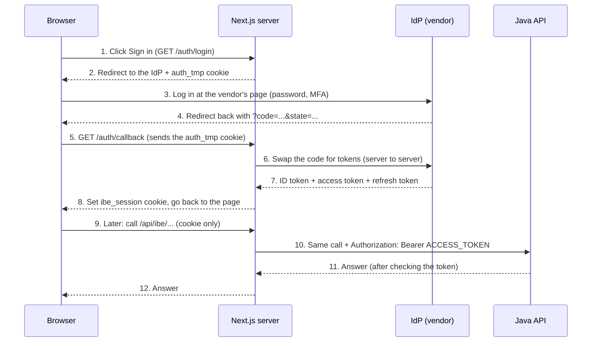

# How our login works, explained simply

A walk-through of the IBE login for anyone on the team, including people new to OAuth and OIDC. Read it top to bottom once; later it works as a reference.

For the setup steps, environment variables and test results, see [ibe-login.md](ibe-login.md). This page is about **understanding**, not configuring.

---

## 1. The big picture

We do **not** check passwords ourselves. A separate system, the **identity provider** (IdP, built by the vendor at `abc.ibe.com`), owns the login page, the passwords and MFA. Our job is only to:

1. send the user to the IdP,
2. receive proof that the user logged in,
3. remember who they are after that.

Think of a concert. You show your ID at the **ticket office** (the IdP). They give you a **wristband**. At the gates, staff (our site and our API) never ask for your ID again, they just look at the wristband.

---

## 2. Who is who

| Name               | What it is                                                         | Where it lives                                    |
| ------------------ | ------------------------------------------------------------------ | ------------------------------------------------- |
| **Browser**        | What the user clicks in                                            | The user's machine                                |
| **Next.js server** | Our website's server side. It runs the login and holds the secrets | `apps/frontend`                                   |
| **IdP**            | The vendor's login system. It knows the user and signs the proof   | `abc.ibe.com` (locally: the mock IdP or Keycloak) |
| **Java API**       | Our backend. It trusts only requests that carry a valid token      | `apps/java-api`                                   |
| **Session store**  | A small server-side database of "who is logged in"                 | Redis (in memory when developing)                 |

The most important rule of the whole design:

> **The browser only ever holds a ticket number. All the real credentials (tokens) stay on our server.**

Why? If a script on a web page could read the tokens (an "XSS" attack), it could steal the login. A random ticket number is useless to a thief without our server's records behind it.

---

## 3. The login, step by step



In plain words:

1. You click **Sign in**.
2. Our server prepares a few secrets, saves them in a short-lived cookie (`auth_tmp`) and sends you to the IdP.
3. You log in on the vendor's page. Our site never sees your password.
4. The IdP sends your browser back to us with a one-time **code**.
5. Our callback checks that this login is really the one _this browser_ started.
6. Our server (not the browser) swaps the code for **tokens** with the IdP.
7. We check the tokens are genuine.
8. We store them in the session store and give the browser only a ticket number, the `ibe_session` cookie.
9. From then on, every request carries just that cookie. Our server looks up the tokens and adds the right one when it calls the Java API.

### What comes back in the callback

When the IdP sends the browser back to `/auth/callback`, three kinds of information are involved.

**1. In the URL** (`/auth/callback?code=...&state=...`):

| Parameter                                   | What it is                                                          | What we do with it                           |
| ------------------------------------------- | ------------------------------------------------------------------- | -------------------------------------------- |
| `code`                                      | A one-time pass, valid for about a minute                           | We swap it for tokens (server to server)     |
| `state`                                     | Our own random string, echoed back                                  | We compare it with the `state` in the cookie |
| `error` (and sometimes `error_description`) | Only if the login failed or was denied, for example `access_denied` | We show the error page                       |

Some real IdPs add more (Keycloak, for example, adds `iss` and `session_state`). Our code reads only `code`, `state` and `error` and ignores the rest.

**2. Sent by the browser on its own:** the `auth_tmp` cookie (`state`, `nonce`, `verifier`, `returnTo`, `iat` + signature).

**3. What happens next, on the server only.** Our server calls the IdP's **token endpoint** directly. The browser never sees this call.

| We send                                         | Why                                                                                  |
| ----------------------------------------------- | ------------------------------------------------------------------------------------ |
| `grant_type=authorization_code`                 | "I'm swapping a code for tokens"                                                     |
| `code`                                          | The one-time pass                                                                    |
| `redirect_uri`                                  | Must be identical to the one used at the start                                       |
| `code_verifier`                                 | The secret from the cookie, checked against the fingerprint the IdP got at the start |
| `Authorization: Basic ...` (client id + secret) | Proves it really is our app                                                          |

| The IdP answers with | Why                                                                                         |
| -------------------- | ------------------------------------------------------------------------------------------- |
| `id_token`           | Signed proof of who logged in. We check its signature, issuer, audience, expiry and `nonce` |
| `access_token`       | The pass our Java API checks on every call                                                  |
| `refresh_token`      | Used later to get a new access token                                                        |
| `expires_in`         | How long the access token lasts, in seconds                                                 |
| `token_type`         | `Bearer`                                                                                    |

If every check passes, we store the tokens on the server, set the `ibe_session` cookie, delete `auth_tmp` and send you to `returnTo`. In the browser, only `code` and `state` ever appear in the URL. The tokens never do.

The code is in `app/auth/callback/route.ts` and `tokenRequest` in `lib/oidc/oidc.ts`.

---

## 4. The two cookies

|           | `auth_tmp`                                                    | `ibe_session`                                     |
| --------- | ------------------------------------------------------------- | ------------------------------------------------- |
| Purpose   | Remember what we decided at the **start** of a login          | Prove "this browser is logged in"                 |
| Set when  | You click Sign in                                             | A login **succeeds** (end of the callback)        |
| Holds     | `state`, `nonce`, `verifier`, `returnTo`, `iat` + a signature | Only a random ticket number                       |
| Lives     | At most 10 minutes, deleted after the callback                | About 1 hour from login (`SESSION_TTL_SECONDS`)   |
| Sent to   | Only `/auth/*`                                                | Every page and API route                          |
| If stolen | Almost useless (see section 5)                                | **A full login until it expires or you sign out** |

Both are `HttpOnly` (page scripts cannot read them) and `SameSite=Lax` (not sent on most cross-site requests). In production they are also `Secure` (HTTPS only).

Your session also has a hard cap (`SESSION_MAX_AGE_SECONDS`, 8 hours by default), after which you must log in again.

---

## 5. The `auth_tmp` cookie, field by field

**The problem it solves.** Login takes two separate requests, and our server remembers nothing between them. So before the browser leaves, we put a "sticky note" in a cookie, and read it when the browser returns.

### `state`: "Is this _my_ login?"

- **What:** a random string we make up and send to the IdP. The IdP must return it unchanged in the URL.
- **Attack stopped, login CSRF:** an attacker logs in at the IdP with _their own_ account and emails you the callback link. If you click it, our site would log **you** in as **them**. You might then save your personal details in their account.
- **Why it works:** their link carries _their_ `state`, your cookie holds _yours_. They don't match, so we refuse.

### `nonce`: "Was this ID token made for this login?"

- **What:** another random string. The IdP writes it _inside_ the ID token (the signed proof of who you are).
- **Attack stopped, token replay:** someone captured an old ID token and tries to reuse it.
- **Why it works:** an old token carries an old nonce, which doesn't match the one in your cookie.

### `verifier`: "Prove you started this" (PKCE)

- **What:** a secret random string. At the start we send only its **hash** (a one-way fingerprint) to the IdP. When we swap the code for tokens, we send the real value and the IdP checks that it fits the fingerprint.
- **Attack stopped, stolen code:** the `code` travels through the browser's URL, so it could be intercepted. Without the verifier, a stolen code is useless.
- **Remember:** this is a secret. It must never go in a URL, which is exactly why it lives in a cookie.

**Why keep the `verifier` in the cookie?**

PKCE only works if the **same app** that _started_ the login also _finishes_ it. At the start we send the IdP only a fingerprint (hash) of the `verifier`. At the end we must show the real one. But the start and the end are two separate requests, and the server remembers nothing between them, so the `verifier` has to be stored somewhere in between.

| Where we could keep it                         | Problem                                                                                                              |
| ---------------------------------------------- | -------------------------------------------------------------------------------------------------------------------- |
| In the URL (`?verifier=...`)                   | URLs leak: browser history, server logs, the `Referer` header, extensions. It is a secret, so this defeats the point |
| At the IdP                                     | The IdP must **not** have it. It only gets the hash, so it can check us later                                        |
| In a server-side store keyed by `state`        | Works, but needs storage (Redis) for something that lasts a few minutes                                              |
| In a **signed `HttpOnly` cookie** (what we do) | No storage needed, page scripts can't read it, and it is tied to the browser that started the login                  |

What goes wrong without it? Suppose an attacker gets hold of the one-time `code` (from a log, the browser history or a malicious extension):

- **Without PKCE**, the code is worth much more to them.
- **With PKCE**, the IdP asks "what is the `verifier` behind this code's fingerprint?" The attacker doesn't have it, because it never left our server and the user's cookie. The code is useless.
- A related attack is **code injection**: the attacker logs in with their own account and slips _their_ code into _your_ callback. Their code is tied to _their_ verifier, which doesn't match yours, so it is rejected.

For us the client secret already blocks most of this. PKCE is a second lock, and it is the current best practice for every kind of app.

### `returnTo`: "Where do I send them afterwards?"

- **What:** the page you were on, for example `/booking`.
- **Attack stopped, open redirect:** if we accepted any value, a link with `?returnTo=https://evil.com` would send you to a fake site right after a _real_ login, where you'd trust it. We only allow paths on our own site (`/something`), never `//evil.com` or `https://...`. We check this twice: when you start, and again in the callback.

### `iat` ("issued at"): "How old is this?"

- **What:** the time the cookie was created.
- **Why:** the browser deletes the cookie after 10 minutes, but a browser can't be trusted (someone could keep a copy). So the **server** also rejects anything older than 10 minutes.

### The signature: "Did _we_ make this?"

A cookie is just text in the user's browser, so anyone can edit it. We add a **signature** (an HMAC made with a secret only the server knows). Change one character and the signature no longer matches, so we reject it. Nobody can create a valid cookie without the secret.

> **Is `auth_tmp` dangerous if someone sees it?** Almost not. It holds no identity and no tokens. To use it, an attacker would also need a valid, unused authorization code for that exact login, **and** our client secret to exchange it. It is dead after 10 minutes. The cookie to protect is `ibe_session`.

---

## 6. How the Java API checks a request

The Java API knows nothing about cookies or sessions. It only accepts a **bearer token** (the access token), and checks it every time:

| Check                                             | What it stops                                          |
| ------------------------------------------------- | ------------------------------------------------------ |
| **Signature**, using the IdP's public keys        | A token someone forged or edited                       |
| **`iss`** (issuer) is our IdP                     | A token made by some other system                      |
| **`aud`** (audience) contains our API             | A token the IdP made for a _different_ application     |
| **`exp`** (expiry) is in the future               | An old token                                           |
| **Scope** (`booking.read`, for the list endpoint) | A logged-in user using something they were not granted |

It then identifies the caller **only** by the token's `sub` (subject, the user id), never by anything in the request body, query string or headers. If it trusted a `userId` sent by the client, anyone could ask for someone else's bookings.

What the status codes mean:

| Code  | Meaning                                                                                          |
| ----- | ------------------------------------------------------------------------------------------------ |
| `401` | No token, or the token is invalid, expired or for the wrong audience. The user must log in again |
| `403` | The token is valid but lacks the needed scope. Logging in again won't help                       |
| `503` | We couldn't check the token because the IdP is down. The user is **not** necessarily logged out  |

---

## 7. What happens when...

**...the user waits more than 10 minutes on the IdP page, then clicks Log in?**
The `auth_tmp` cookie has expired, so the callback has nothing to compare with and refuses. The user sees "Could not log you in" with a **Try again** button. No session is created.

**...someone edits the `auth_tmp` cookie?**
The signature no longer matches, and the callback refuses (`bad_login_state`).

**...the access token expires while the user is browsing?**
Our server quietly uses the **refresh token** to get a new one. The user notices nothing. If several requests arrive at once, only one refreshes and the others wait for the result (some IdPs allow each refresh token to be used only once).

**...the IdP says the refresh token is no longer valid?**
We delete the session. The user's next request is a `401` and they log in again.

**...the user clicks Sign out?**
We delete the session record on the server, clear the cookie, and also end the session at the IdP. A copy of the old cookie value is now worthless.

**...a stranger gets a copy of someone's `ibe_session` value?**
That is a full login until it expires or the user signs out. This is why it is `HttpOnly`, `Secure` in production, and why you should never paste it into a chat or a ticket.

**...the IdP is down?**
Sign in shows "The identity provider is not reachable right now". Already logged-in users keep working until their token needs a refresh.

**...someone opens the login in two tabs?**
The second login overwrites the first tab's `auth_tmp`, so the first tab fails with an error. That is a minor annoyance, not a security problem.

---

## 8. Things we never do

- Put a token in a URL, a log line, a cookie or `localStorage`.
- Let the browser call the Java API directly. It always goes through `/api/ibe/*`.
- Trust a user id sent by the client.
- Keep the client secret in git. It belongs in a secrets manager.

---

## 9. Where to look in the code

| Question                                  | File                                                                                 |
| ----------------------------------------- | ------------------------------------------------------------------------------------ |
| What happens when I click Sign in?        | `apps/frontend/app/auth/login/route.ts`                                              |
| What does the callback check?             | `apps/frontend/app/auth/callback/route.ts`                                           |
| How are `auth_tmp` and PKCE made?         | `apps/frontend/lib/oidc/oidc.ts` (`signLoginState`, `readLoginState`, `challengeOf`) |
| Where are sessions stored?                | `apps/frontend/lib/oidc/session-store.ts`                                            |
| How is an expired access token refreshed? | `apps/frontend/lib/oidc/auth.ts`                                                     |
| How does the browser reach Java?          | `apps/frontend/app/api/ibe/[...path]/route.ts`                                       |
| How does Java check tokens?               | `apps/java-api/.../security/SecurityConfig.java`                                     |
| The Sign in button in the header          | `apps/frontend/components/auth-nav.tsx`                                              |

---

## 10. See it yourself

1. Start the mock IdP (`pnpm idp:mock`) and the app. Open DevTools, then the **Network** tab with **Preserve log** ticked.
2. Click **Sign in** and open the `login` request. In **Response Headers** you will see `set-cookie: auth_tmp=...; Max-Age=600; Path=/auth; HttpOnly`.
3. Decode the first part of the value (before the dot) to see what is inside:
   ```
   node -e "console.log(Buffer.from(process.argv[1],'base64url').toString())" "<first part>"
   ```
   You will see `state`, `nonce`, `verifier`, `returnTo` and `iat`.
4. Click **Log in** on the mock page. Open **Application → Cookies**: `auth_tmp` is gone and `ibe_session` exists. Its value is only a random id.
5. On the Account page, press **Call /api/bookings/me**. The browser sent only the cookie, and our server added the token when it called Java.

---

## 11. Glossary

| Term                        | In one line                                                                                                             |
| --------------------------- | ----------------------------------------------------------------------------------------------------------------------- |
| **IdP** (identity provider) | The system that owns the login page and passwords                                                                       |
| **OAuth 2.0**               | The standard for "let this app act for this user" without sharing passwords                                             |
| **OIDC** (OpenID Connect)   | OAuth plus a standard way to learn _who_ the user is (the ID token)                                                     |
| **Authorization Code flow** | The login dance where the browser carries a short-lived code and the server swaps it for tokens                         |
| **PKCE**                    | Extra protection so a stolen code can't be used (the `verifier` and its hash)                                           |
| **Access token**            | A short-lived pass the Java API checks on every call                                                                    |
| **ID token**                | A signed statement of who logged in. Used once, at login                                                                |
| **Refresh token**           | A longer-lived key to get a new access token without logging in again                                                   |
| **JWT**                     | A signed token format: three dot-separated parts. Anyone can read it, nobody can edit it without breaking the signature |
| **Claim**                   | One fact inside a token, such as `sub`, `email`, `aud`, `exp`                                                           |
| **Scope**                   | A permission such as `booking.read`                                                                                     |
| **Session**                 | Our server-side record of "this ticket number is this user"                                                             |
| **CSRF**                    | An attack that makes your browser do something on a site you're logged into                                             |
| **XSS**                     | An attack that runs a script inside a page. `HttpOnly` cookies are hidden from it                                       |
| **HttpOnly**                | Cookie flag: page scripts cannot read it                                                                                |
| **SameSite=Lax**            | Cookie flag: not sent on most cross-site requests                                                                       |
| **Secure**                  | Cookie flag: only sent over HTTPS                                                                                       |
| **HMAC / signature**        | A fingerprint made with a secret key. Proves the data wasn't changed                                                    |

---

## 12. Questions people ask

**Why not just store the token in the browser?**
Any script that runs on the page (a compromised library, an XSS bug) could read it and steal the login. Keeping it on the server removes that risk.

**Why does the server swap the code, not the browser?**
That step needs our **client secret**, which must never be in the browser. The server proves to the IdP that it really is our app.

**Why is the `verifier` stored in a cookie and not somewhere else?**
It has to survive from the start of the login to the end, it must stay secret (so not in a URL), and a cookie needs no server storage. See section 5.

**What does the IdP send back to the callback?**
Only a one-time `code` and our own `state` in the URL. The tokens come later, in a direct server-to-server call. See section 3.

**Why a separate cookie for the login start, rather than the session cookie?**
At that point there is no session yet. And the start-of-login data (especially the verifier) must not be reused as a login credential.

**Why check `returnTo` twice?**
The cookie is signed, so it shouldn't be forgeable. We check again anyway: one extra line costs nothing, and it keeps the redirect safe even if some other bug lets a bad value through. Layers of defence.

**What if the vendor's tokens aren't JWTs?**
Then Java asks the IdP "is this token valid?" for each call (token introspection) instead of checking a signature. See section 6.5 of the original guide.
