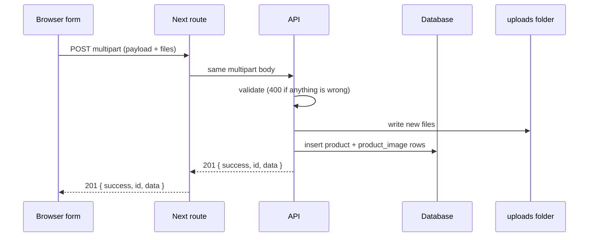
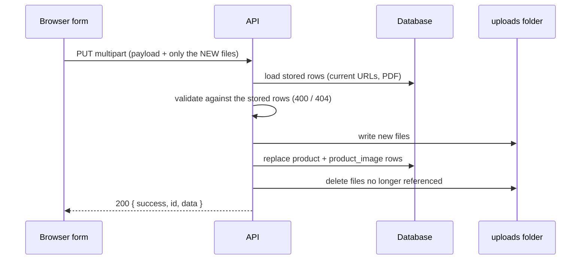

# Product upload: add and update

How a product with images and a PDF is added and updated, from the form to the
database. This is the contract between the UI and the backend, followed by the
points we still need to decide.

- **Endpoints:** `POST /demo/products` (add), `PUT /demo/products/{id}` (update),
  `GET /demo/products/{id}` (read).
- **Implementations:** Java (`apps/java-api`, H2 database) and Express (`apps/api`,
  in-memory). Same endpoints, same rules, same responses.
- **Browser path:** the browser calls the Next routes `/api/product-demo` and
  `/api/product-demo/{id}`, which forward the same multipart body to the API.
- **Examples** use dummy values (`SampleCategory`, `SAMPLE`).
- Related files: OpenAPI specs in `apps/api/docs/` and `apps/java-api/docs/`, the
  slide deck `docs/product-upload-flow.pptx`, and the case tests
  `apps/api/docs/product-demo-cases.py`.

---

## 1. The request format (add and update)

One `multipart/form-data` request with up to three kinds of parts:

| Part | Type | Content |
|---|---|---|
| `payload` | text | JSON: the product fields, the image list and the PDF value |
| `productImage` | file, repeated | One part per **new** image. The part's **filename is the image id** |
| `productPdf` | file, optional | At most one PDF. The part's **filename is the PDF id** |

```json
{
  "category": "SampleCategory",
  "product": {
    "ssrCode": "SAMPLE",
    "price": 500,
    "productImage": [
      { "image": "product-image-1", "description": "Front view" }
    ],
    "productPdf": "product-pdf"
  }
}
```

JSON cannot carry binary data, and base64 would make the body about a third bigger
and hold whole files in memory as strings. So the files travel as multipart parts
and the JSON refers to them by **id**.

### Ids

| What | Value | Rule |
|---|---|---|
| New image | `product-image-N` (N = 1-based position in the list at submit time) | Goes in `productImage[].image` **and** is the filename of its file part |
| New PDF | `product-pdf` | Goes in `product.productPdf` **and** is the filename of the `productPdf` part |
| Kept image (update only) | the image's **current URL**, exactly as the API returned it | No file part |
| Kept PDF (update only) | the PDF's **current URL** | No file part |

- Ids only need to be unique **within one request**. The backend adds a random suffix when
  it stores the file, so two requests never overwrite each other.
- Allowed characters: `A-Z a-z 0-9 - _`, 1 to 64 characters.
- Matching is **by id, never by position or file name**. The same picture added twice
  is two ids, two files and two images.

---

## 2. Add (`POST /demo/products`)

### What the UI does

1. The user fills in the product fields.
2. Each "Add item" gives one image plus a description. At submit, item *i* gets the id
   `product-image-{i}`.
3. An optional PDF gets the id `product-pdf`.
4. The UI builds `FormData`: `payload` (JSON string), one `productImage` part per item
   (`formData.append("productImage", file, id)`), and `productPdf` if a PDF was chosen.
5. It posts to `/api/product-demo`, **without** setting `Content-Type`, so the browser
   adds the multipart boundary itself.
6. On `201`, the UI keeps the returned `id` and shows the saved images from their URLs.

### What the backend does, in order

1. **Read** the multipart body into the `payload` text and the file parts.
2. **Validate everything** (section 5). If anything fails: `400`, nothing is stored and
   nothing is written to disk.
3. **Store the files** as `uploads/<id>-<random8>.<ext>`. Each file gets a URL.
4. **Save to the database**: one `product` row, one `product_image` row per image
   (with its `position`), and `pdf_url`.
5. **Respond `201`** with `{ success, id, data }`, where every image id is replaced by its
   stored URL.



---

## 3. Update (`PUT /demo/products/{id}`)

Update **replaces** the stored product. Send the whole product, not only what changed.
The only difference from add is what an image entry may be.

### What each UI action sends

| UI action | `productImage` entry | File part |
|---|---|---|
| Edit a description | `{ image: <current URL>, description: "new text" }` | none |
| Replace an image | `{ image: "product-image-N" }` (the old URL is left out) | new file, filename = that id |
| Add an image | `{ image: "product-image-N" }` | new file, filename = that id |
| Remove an image | the entry is **left out** of the list | none |
| Reorder images | entries in the new order | none |

| PDF action | `productPdf` | File part |
|---|---|---|
| Keep | the current URL | none |
| Replace | `"product-pdf"` | new PDF, filename = `product-pdf` |
| Remove | leave the field out | none |
| Add (had none) | `"product-pdf"` | new PDF |

After a successful save the UI replaces its items with what the server returned (stored
images become "kept" items with their URL), so the next update starts from the stored state.

### What the backend does, in order

1. **Load the stored product** (`product` + `product_image` rows). Unknown id: `404`.
   This gives the product's **current image URLs** and **current PDF URL**.
2. **Validate** with the same rules as add, plus: each image entry is a **new id** or
   **one of this product's current URLs**; a URL that belongs to another product, or that
   was already removed, is rejected. At least 1 and at most 10 images **in total**
   (kept + new).
3. **Store only the new files.** Kept images are neither re-uploaded nor touched.
4. **Save to the database**: replaces the `product` row and its `product_image` rows in
   the new order. If this fails, the files written in step 3 are removed again and the old
   data is untouched.
5. **Delete files that are no longer used**, only after the save succeeded:
   `removed = (current URLs) - (URLs in the new list)`, plus the old PDF if it was
   replaced or left out.
6. **Respond `200`** with `{ success, id, data }`.



### How a removed image is found

The request never mentions a removed image. The backend finds it by comparing the
request with the database: any stored image URL that is **not** in the new list is removed.
A replaced image is found the same way, because its old URL is not in the new list.
(Java: `save()` in `ProductDemoController.java`; Express: `saveProduct()` in
`product-demo.controller.ts`.)

### Why this order

`validate -> write new files -> save database -> delete old files`

| If it fails at | Result |
|---|---|
| Validate | `400`. Nothing changed |
| Write new files | Already-written new files are removed. Old data untouched |
| Save database | New files removed again. Database and old files untouched |
| Delete old files | The product is already saved. Worst case: a leftover unused file. The database never points at a missing file |

---

## 4. Read (`GET /demo/products/{id}`)

Returns `200 { success, id, data }` or `404 { success: false, error: "Product not found" }`.

---

## 5. Validation rules (both backends)

All failures return `400 { success: false, error: "<message>" }` and change nothing.

| Rule | Applies to |
|---|---|
| `payload` is valid JSON; `category` is a non-empty string; `product.ssrCode` is a non-empty string; `product.price` is a number >= 0 | add, update |
| `productImage` is a list of `{ image, description? }`; `description`, if present, is a string | add, update |
| Each `image` is a valid id (add), or a valid id / one of this product's current URLs (update) | add, update |
| No duplicate `image` values | add, update |
| 1 to 10 images in total | add, update |
| Every new id has exactly one file part with that filename, and every file part has an id | add, update |
| Image parts are `image/*`, at most 5 MB each | add, update |
| `productPdf` is absent, or a valid new id with a matching `application/pdf` part (add: no URL form), or on update the current PDF URL with no file | add, update |
| Sending a PDF file without an id (or an id without a file) is rejected | add, update |
| Unknown product id | update, read: `404` |

Error bodies for an id/file mismatch also list `missingFiles` and `unreferencedFiles`.

---

## 6. Where the data is saved

**Database (Java: H2 file `apps/java-api/data/productdb.mv.db`; Express: in memory)**

| Table | Columns |
|---|---|
| `product` | `id` (uuid), `category`, `ssr_code`, `price`, `pdf_url`, `details` (the rest of the product JSON) |
| `product_image` | `id`, `product_id` (-> `product.id`), `position` (0-based order), `url`, `description` |

**Files:** `uploads/<id>-<random8>.<ext>`, for example `product-image-1-ab12cd34.jpg`
(extension from the MIME type: jpg, png, gif, webp, pdf). The URL in the response and in the
database is `<scheme>://<host>/uploads/<file name>`. The database keeps URLs; the folder
keeps the bytes.

**Limits:** 5 MB per file; 10 images per product; one optional PDF; request size up to
60 MB (Java); `image/*` for images, `application/pdf` for the PDF.

---

## 7. Responses

| Case | Status | Body |
|---|---|---|
| Added | `201` | `{ success: true, id, data }` |
| Updated / read | `200` | `{ success: true, id, data }` |
| Rejected | `400` | `{ success: false, error, ... }` |
| Unknown product id | `404` | `{ success: false, error: "Product not found" }` |
| API not reachable from the Next route | `502` | `{ success: false, error: "Cannot reach the API at ..." }` |

`data` has the same shape as the request payload, with every `productImage[].image` replaced
by its stored URL and `productPdf` replaced by its URL.

---

## 8. Who owns what

**UI**
- Build the ids from the item position at submit time (`product-image-N`, `product-pdf`).
- Send **only new files**; send stored images and the stored PDF as their **current URL**.
- Leave out removed images and a removed PDF.
- Do not set `Content-Type` on the request.
- After a save, refresh local state from the response (stored URLs, new `id`).
- Show backend `error` messages; a `400` means nothing was saved.

**Backend**
- Validate everything before writing anything.
- Pair files and payload entries by id, never by position.
- Load the stored product on update and compare; delete only what is no longer referenced.
- Order: write new files, save the database, then delete old files.
- Return stored URLs for every image and the PDF.

---

## 9. Tests

`apps/api/docs/product-demo-cases.py` runs 32 cases against a running API and checks the
response, which files are served or deleted, that rejected requests change nothing, and
that `GET` returns what was saved. All 32 pass on both backends. Cases covered:

- **Images:** add 2; replace 1 and add 1; remove 1 and add 1; remove all and add 1;
  edit descriptions only; reorder; remove 1; replace all; same picture twice; grow to 10;
  resend unchanged; clear a description; new image first.
- **PDF:** add; replace; keep while changing images; remove; remove and replace all images.
- **Rejected (nothing changes):** remove all and add none; 11 images; id without a file;
  file not listed; non-image; image over 5 MB; URL of another product; stale URL; same
  URL twice; unsafe id; PDF id without a file; image sent as PDF; unknown product id.

---

## 10. Open points to decide

| # | Topic | Today | Suggestion |
|---|---|---|---|
| 1 | **Image identity on update** | The image's URL is its identity ("kept" = send the same URL) | Return a stable image id from the API and use it instead of the URL |
| 2 | **URL host** | URLs are absolute and built from the request's host, and stored in the database | Store a relative key and build the URL on read (config base URL or CDN), so a host change does not break saved data |
| 3 | **Concurrent edits** | Last write wins, no locking | Add a version or ETag and reject stale updates (`409`) |
| 4 | **File storage** | Local `uploads/` folder | Object storage (S3 or similar) |
| 5 | **Orphan files** | A crash between "save" and "delete" leaves an unused file | Periodic cleanup job comparing the folder with the database |
| 6 | **Partial updates** | `PUT` replaces everything | Keep `PUT`, or add `PATCH` for field-level edits |
| 7 | **Delete product** | Not implemented | Add `DELETE`, which must also remove the product's files |
| 8 | **Field length checks** | `description` max 4000 and URLs max 1000 in the database; only types are validated | Validate lengths up front so the user gets a `400`, not a database error |
| 9 | **Other product fields** | Only `category`, `ssrCode` and `price` are validated; any other fields are stored as given | Define and validate the full product schema |
| 10 | **File type check** | Trusts the client's `Content-Type` | Also check the file's magic bytes |
| 11 | **Two backends** | Java persists in H2, Express keeps products in memory | Pick one as the source of truth; keep the case tests as the shared contract |
| 12 | **Limits** | 10 images, 5 MB per file, one PDF | Confirm the business values, and whether the PDF needs its own size limit |
| 13 | **Auth** | None on these endpoints | Decide who may add, update and read products |
